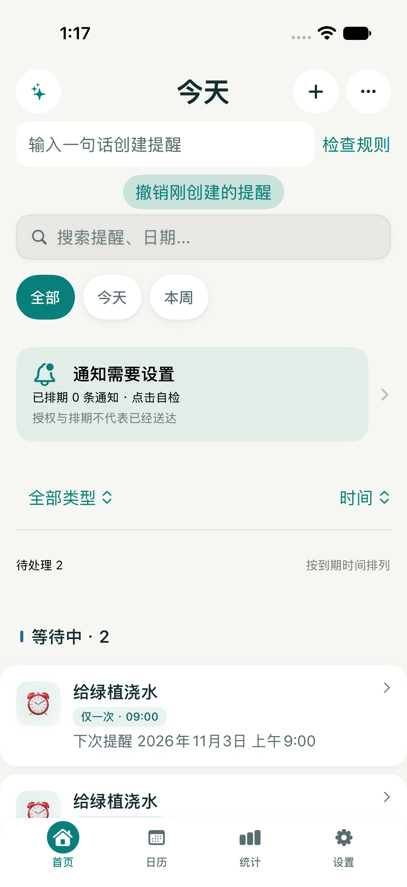
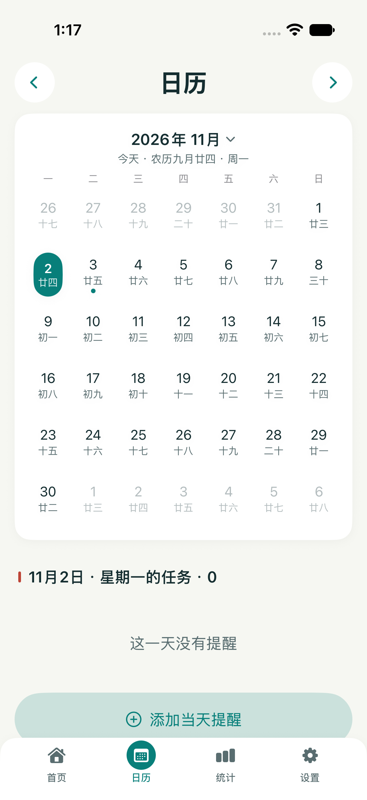
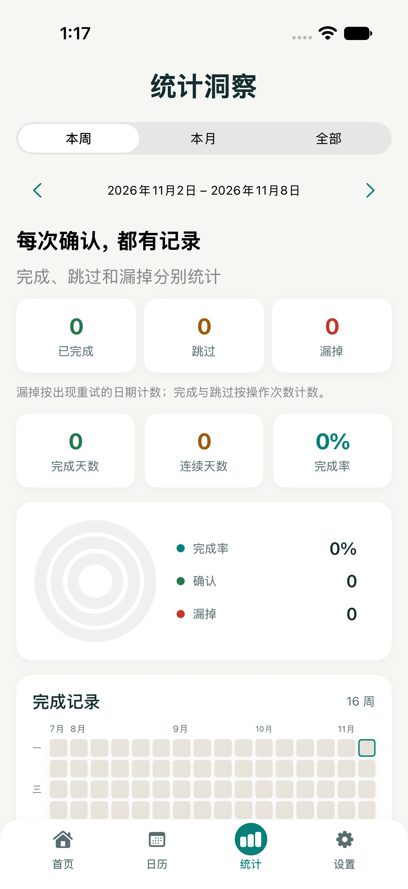
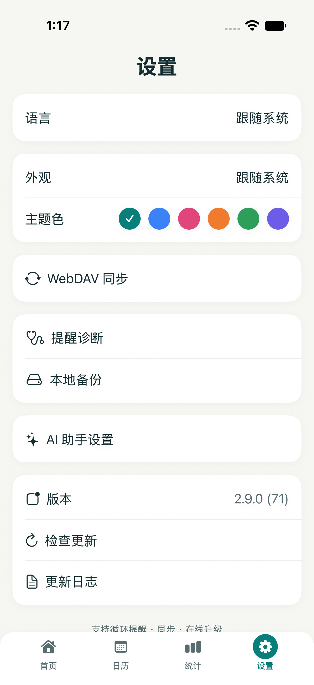

[简体中文](README.md) · [English](README.en.md) · [繁體中文](README.zh-TW.md) · [日本語](README.ja.md) · [한국어](README.ko.md)


# 繰り返しリマインダー

**確認が必要なことを、ひと目で。**

iOS と Android のネイティブ通知アプリ。完了を確認すると次の周期へ進み、未確認なら設定した間隔で再通知します。データは端末に保存し、同期は任意です。

バージョン **2.9.1 / 72** · unsigned IPA。ダウンロード状況と更新履歴は Releases を参照してください。

2.9.1 では、内容が変わらない同期での競合の繰り返しと、アップロード失敗後の再試行状態を修正しました。実際の競合は引き続き選択が必要です。[更新内容](docs/releases/v2.9.1.md)。

[**ダウンロード・更新履歴 ↗**](https://github.com/tsumon/reminder-app-ios/releases/latest) · [別のプラットフォーム](https://github.com/tsumon/reminder-app-android)

## 主な機能

| 機能 | iOS | Android |
| :--- | :---: | :---: |
| 周期・日付・旧暦誕生日・祝日・第 N 週のルール | ✓ | ✓ |
| 固定周期 / 完了から再計算 | ✓ | ✓ |
| 軽め / 継続 / 重要、再通知とおやすみ時間 | ✓ | ✓ |
| 完了・後で・明日・スキップ・取り消し | ✓ | ✓ |
| 検索・種類の絞り込み・期限 / 名前 / 優先度順 | ✓ | ✓ |
| 当日の予定・週 / 月の統計・ウィジェット | ✓ | ✓ |
| オフライン自然文・音声・テンプレート・任意の AI | ✓ | ✓ |
| JSON・ICS・近くの端末へ転送・ローカル保存・WebDAV | ✓ | ✓ |

## 3 ステップで開始

1. 手入力、自然文、音声またはテンプレートで入力し、編集画面でルール全体を確認します。
2. 通知の強さ、周期の起点、再通知間隔、おやすみ時間を選び、次の 3 回を確認して保存します。
3. ホームから通知診断を開き、権限と設定を確認します。テストを予約し、実機をロックして確認してください。

## 実行画面

実際に動作した画面のみ掲載。サンプルは専用テスト端末のデータで、既定のユーザーデータではありません。

<p align="center">
  
  
</p>
<p align="center">
  
  
</p>

[Create form](docs/screenshots/runtime-2.9/create.png) · [Capture details](docs/screenshots/runtime-2.9/README.md)

## 繰り返しの仕組み

**固定周期**は遅れて完了しても元の予定を維持します。祝日前に移動した通知を早く完了すると、元の周期を消化します。**完了から再計算**は実際の確認時刻を起点にします。既存の設定は維持します。

**軽め**は自動通知 1 回。**継続**の初期値は 60 → 240 → 720 → 1440 分、初回を含め最大 5 回で、各間隔を編集できます。**重要**も OS の権限に従います。再通知はおやすみ時間を守ります。

端末の暦と保存済みの基準タイムスタンプで計算します。時区を変えても既存の時刻は書き換えません。次の通知を確認してください。プレビューは定刻の確認を想定し、休日データで変わる場合があります。

完了とスキップは操作回数、未確認は再通知があった日数を別々に表示します。未確認の記録は通知の実配信を証明しません。

## 同期と復元

自分の WebDAV サーバーを使用します。両端の変更が競合すると選択を待ち、書き込み前に非公開のローカルコピーを保存します。ETag 条件付き更新を維持。v4 は固定 ID で履歴を統合し、削除済みの通知や取り消した記録の復活を防ぐマーカーを保持します。

履歴と削除の完全な同期には両端の更新が必要です。v1–v3 は読み込めますが、旧クライアントは新メタデータを保持しません。ID のない古いファイルでは削除を確実に識別できません。マーカーは失効せず、復元時は新 ID にコピーします。v4 の完全バックアップを保管してください。単体共有カードは全体の削除情報を含みません。

## インストールと上書き更新

iOS 17+。Release は unsigned IPA を生成します。元の署名・サイドロード経路を継続してください。App、Widget、App Group の ID は維持しますが、元の署名経路がなければ上書き更新やデータ継続は保証できません。

## 通知状態の意味

権限や予約数は設定状態を示し、配信済みを意味しません。消音、集中モード、通知チャンネル、省電力、メーカーのバックグラウンド制限の影響を受けます。実機のロック中・再起動後・バックグラウンドで確認してください。

iOS の通常通知には予約数の制限があります。iOS 26+ の重要通知は AlarmKit を別途許可でき、利用不可なら通常通知に戻ります。

## ローカルビルド

Xcode 26.3+ · XcodeGen · iOS 17+

```sh
xcodegen generate
xcodebuild build -project ReminderApp.xcodeproj -scheme ReminderApp \
  -sdk iphonesimulator -destination "generic/platform=iOS Simulator" \
  CODE_SIGNING_ALLOWED=NO
xcodebuild build -project ReminderApp.xcodeproj -scheme UpgradeCheck \
  -destination "platform=macOS" -derivedDataPath DerivedDataChecks CODE_SIGNING_ALLOWED=NO
./DerivedDataChecks/Build/Products/Debug/UpgradeCheck
```

App: `com.reminder.app` · Widget: `com.reminder.app.widget` · App Group: `group.com.reminder.app`

Release: `CODE_SIGNING_ALLOWED=NO` (unsigned IPA).

## プライバシー

通知と履歴は端末に保存します。AI は設定したサービスへ会話と関連データを送信します。WebDAV・近くへの共有・エクスポートにも通知データを含むため、信頼できる接続先を選び、バックアップを保管してください。

[**検証とプロトコル →**](docs/upgrade-2.9.md) · [Validation](docs/validation-2.9.md)
