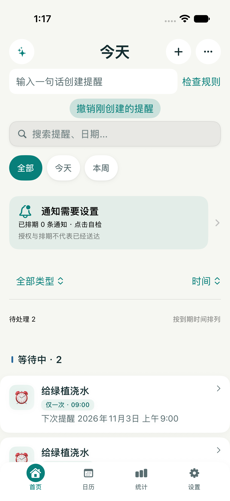
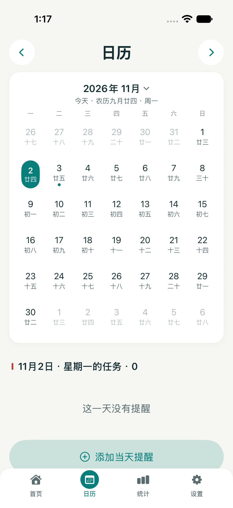
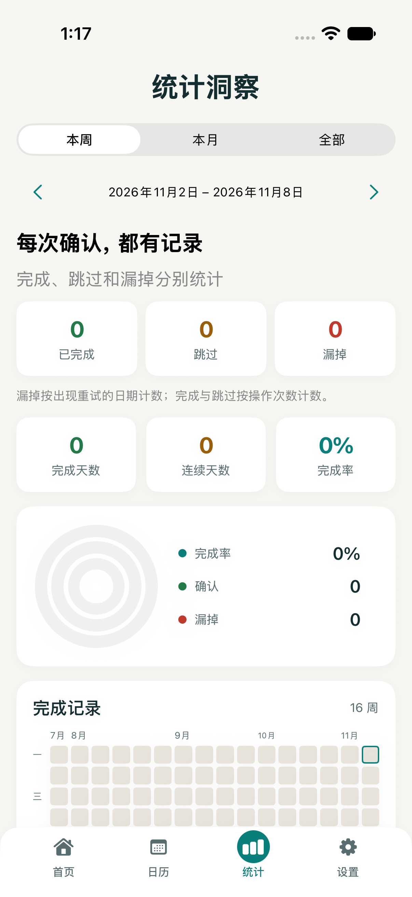
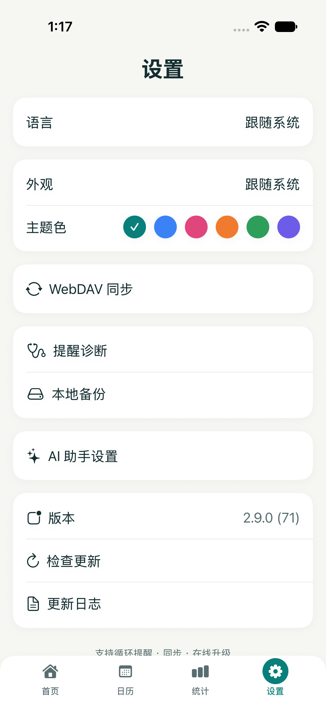

[简体中文](README.md) · [English](README.en.md) · [繁體中文](README.zh-TW.md) · [日本語](README.ja.md) · [한국어](README.ko.md)


# 반복 알림

**확인이 필요한 일을 한눈에.**

iOS와 Android 네이티브 알림 앱입니다. 완료를 확인하면 다음 주기로 넘어가며, 확인하지 않으면 설정한 방식과 간격으로 다시 알립니다. 데이터는 기기에 저장하고 동기화는 선택합니다.

버전 **2.9.1 / 72** · unsigned IPA. 다운로드 상태와 변경 내역은 Releases를 확인하세요.

2.9.1은 내용이 바뀌지 않은 동기화의 반복 충돌 알림과 업로드 실패 후 재시도 상태를 수정합니다. 실제 충돌은 계속 선택이 필요합니다. [업데이트 안내](docs/releases/v2.9.1.md).

[**다운로드 및 변경 기록 ↗**](https://github.com/tsumon/reminder-app-ios/releases/latest) · [다른 플랫폼](https://github.com/tsumon/reminder-app-android)

## 주요 기능

| 기능 | iOS | Android |
| :--- | :---: | :---: |
| 주기·날짜·음력 생일·공휴일·N번째 주 규칙 | ✓ | ✓ |
| 고정 주기 / 완료 후 다시 계산 | ✓ | ✓ |
| 부드럽게 / 지속 / 중요, 재알림 및 방해 금지 | ✓ | ✓ |
| 완료·나중에·내일·건너뛰기·실행 취소 | ✓ | ✓ |
| 검색·유형 조합 필터·시간 / 제목 / 우선순위 정렬 | ✓ | ✓ |
| 당일 일정·주 / 월 통계·위젯 | ✓ | ✓ |
| 오프라인 자연어·음성·템플릿·설정 가능한 AI | ✓ | ✓ |
| JSON·ICS·근처 전송·로컬 백업·WebDAV | ✓ | ✓ |

## 세 단계로 시작

1. 직접 입력하거나 자연어, 음성, 템플릿을 사용한 뒤 편집 화면에서 전체 규칙을 확인하세요.
2. 알림 강도, 주기 기준, 재알림 간격과 방해 금지 시간을 정하고 다음 3회 일정을 미리 본 뒤 저장하세요.
3. 홈에서 알림 점검을 열어 권한과 설정을 확인하고 테스트를 예약한 뒤 실제 기기를 잠가 확인하세요.

## 실행 화면

실제 실행 화면만 표시합니다. 예시 알림은 전용 테스트 기기의 데이터이며 기본 사용자 데이터가 아닙니다.

<p align="center">
  
  
</p>
<p align="center">
  
  
</p>

[Create form](docs/screenshots/runtime-2.9/create.png) · [Capture details](docs/screenshots/runtime-2.9/README.md)

## 반복 방식

**고정 주기**는 늦게 완료해도 원래 일정을 유지합니다. 공휴일 때문에 앞당긴 알림을 일찍 완료하면 원래 주기가 소비됩니다. **완료 후 계산**은 실제 확인 시간을 기준으로 합니다. 기존 정책은 유지합니다.

**부드럽게**는 자동 알림 1회. **지속**은 기본 60 → 240 → 720 → 1440분, 최초 포함 최대 5회이며 간격을 개별 편집합니다. **중요**도 OS 권한을 따릅니다. 재알림은 방해 금지 시간을 지킵니다.

기기 달력과 저장된 기준 타임스탬프를 사용합니다. 시간대를 바꿔도 기존 기준은 변경하지 않으므로 다음 알림을 확인하세요. 미리보기는 정시 확인을 가정하며 공휴일 정보에 따라 바뀔 수 있습니다.

완료와 건너뜀은 작업 횟수, 놓침은 재알림이 발생한 날짜 수로 구분합니다. 놓침 기록은 실제 전달을 증명하지 않습니다.

## 동기화와 복원

자신의 WebDAV 서버를 사용합니다. 양쪽 변경이 충돌하면 선택을 기다리고, 쓰기 전에 비공개 로컬 사본을 저장합니다. ETag 조건부 업로드를 유지합니다. v4는 안정적인 ID로 기록을 병합하고 삭제된 알림과 취소된 기록의 복귀를 막는 표식을 보관합니다.

전체 기록 및 삭제 동기화는 양쪽 업데이트가 필요합니다. v1–v3 백업은 읽을 수 있지만 이전 앱은 새 메타데이터를 버립니다. 안정적인 ID가 없는 오래된 파일은 삭제를 확실히 구분할 수 없습니다. 표식은 만료되지 않으며 삭제된 알림은 새 ID로 복사해 복원하세요. v4 전체 백업을 보관하세요. 단일 공유 카드는 전체 삭제 표식을 포함하지 않습니다.

## 설치 및 덮어쓰기 업데이트

iOS 17+. Release 워크플로는 unsigned IPA를 만듭니다. 원래 서명 / 사이드로드 경로를 계속 사용하세요. App, Widget, App Group ID를 유지하지만 원래 서명 경로가 없으면 덮어쓰기 및 데이터 연속성을 보장할 수 없습니다.

## 알림 상태의 의미

권한과 예약 개수는 설정을 나타내며 실제 전달을 뜻하지 않습니다. 무음, 집중 / 방해 금지, 채널, 절전 및 제조사 백그라운드 제한의 영향을 받습니다. 실제 기기를 잠근 상태, 재부팅 후 및 백그라운드에서 테스트하세요.

iOS 일반 알림에는 예약 개수 제한이 있습니다. iOS 26+ 중요 알림은 AlarmKit을 별도로 허용할 수 있고 사용할 수 없으면 일반 알림으로 돌아갑니다.

## 로컬 빌드

Xcode 26.3+ · XcodeGen · iOS 17+

```sh
xcodegen generate
xcodebuild build -project ReminderApp.xcodeproj -scheme ReminderApp \
  -sdk iphonesimulator -destination "generic/platform=iOS Simulator" \
  CODE_SIGNING_ALLOWED=NO
xcodebuild build -project ReminderApp.xcodeproj -scheme UpgradeCheck \
  -destination "platform=macOS" -derivedDataPath DerivedDataChecks CODE_SIGNING_ALLOWED=NO
./DerivedDataChecks/Build/Products/Debug/UpgradeCheck
```

App: `com.reminder.app` · Widget: `com.reminder.app.widget` · App Group: `group.com.reminder.app`

Release: `CODE_SIGNING_ALLOWED=NO` (unsigned IPA).

## 개인정보

알림과 기록은 기기에 저장합니다. AI는 설정한 서비스로 대화와 관련 내용을 전송합니다. WebDAV, 근처 공유와 내보낸 파일에도 알림 데이터가 포함되므로 신뢰하는 연결을 선택하고 백업을 보호하세요.

[**검증 및 프로토콜 →**](docs/upgrade-2.9.md) · [Validation](docs/validation-2.9.md)
