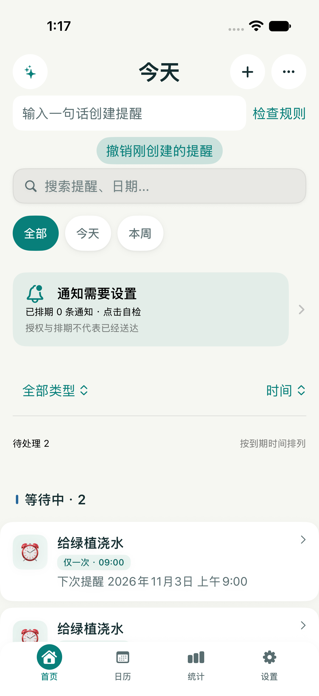
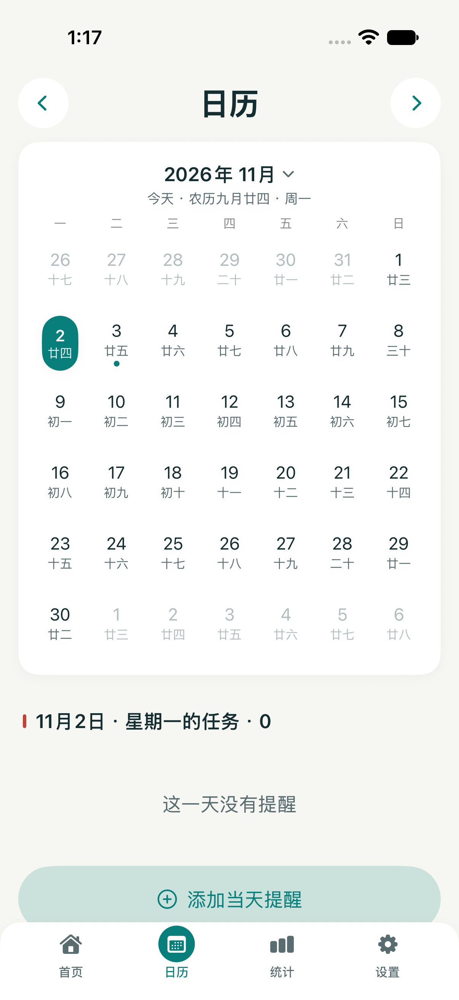
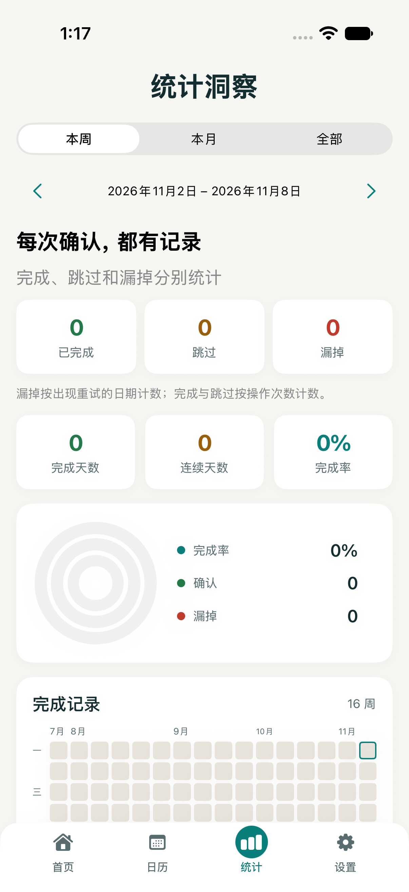
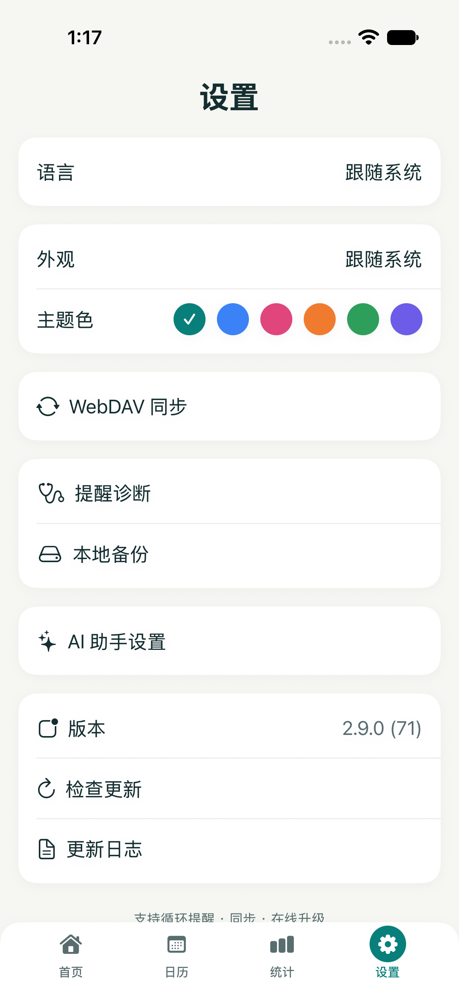

[简体中文](README.md) · [English](README.en.md) · [繁體中文](README.zh-TW.md) · [日本語](README.ja.md) · [한국어](README.ko.md)


# 循环提醒

**把待确认的事，放在第一眼。**

原生 iOS 与 Android 提醒工具。确认后进入下一周期；未确认时按你设定的强度与间隔再次提醒。数据先留在本机，同步由你选择。

源码 **2.9.0 / 71** · 开发分支，尚未发布。公开下载版本以 Releases 为准。

[**下载与版本记录 ↗**](https://github.com/tsumon/reminder-app-ios/releases/latest) · [另一平台](https://github.com/tsumon/reminder-app-android)

## 能做什么

| 能力 | iOS | Android |
| :--- | :---: | :---: |
| 周期、日期、农历生日、节假日、第 N 周规则 | ✓ | ✓ |
| 固定周期 / 完成后重新计时 | ✓ | ✓ |
| 轻柔 / 持续 / 重要，重试与每日勿扰 | ✓ | ✓ |
| 确认、稍后、明天、跳过、撤销 | ✓ | ✓ |
| 搜索、类型组合筛选、时间 / 标题 / 优先级排序 | ✓ | ✓ |
| 日历当天安排、周 / 月统计、小组件 | ✓ | ✓ |
| 离线一句话、语音、模板、可配置 AI 填表 | ✓ | ✓ |
| JSON、ICS、附近分享、本地自动备份、WebDAV | ✓ | ✓ |

## 三步开始

1. 创建提醒，或用一句话、语音与模板填写，再检查完整规则。
2. 选择轻柔、持续或重要；确认周期起点、重试间隔和勿扰时段。预览未来三次安排后保存。
3. 打开首页通知自检，检查权限与系统设置，安排测试提醒并锁屏验证。

## 实装截图

只展示真实运行截图；示例提醒属于独立测试设备，非默认用户数据。

<p align="center">
  
  
</p>
<p align="center">
  
  
</p>

[Create form](docs/screenshots/runtime-2.9/create.png) · [Capture details](docs/screenshots/runtime-2.9/README.md)

## 提醒策略

**固定周期**：晚完成不改变原计划；节假日前移后提前完成会消耗原定周期。**完成后重算**：基于实际确认时间重新计时。旧提醒继续使用原策略。

**轻柔**只自动提醒一次；**持续**默认间隔 60 → 240 → 720 → 1440 分钟，默认最多 5 次（含首次），可逐项编辑；**重要**仍由系统权限决定可用能力。所有重试遵守勿扰。

时间使用设备当前日历与已有锚点时间戳；更换时区不会自动改写旧锚点，请检查下次提醒。预览假设按时确认，节假日数据更新后可能调整。

统计分开显示完成、跳过与漏掉。完成与跳过按操作次数，漏掉按出现重试的日期计数；漏掉不等于系统已经送达通知。

## 同步与恢复

WebDAV 使用你自己的服务器。双方同时修改时暂停并等待选择，覆盖前保存私有本地快照，上传保留 ETag 条件校验。协议 v4 用稳定 ID 合并历史，删除标记防止旧条目与已撤销的记录回流。

完整删除与历史同步需要两端升级。v1–v3 备份仍可读，但旧客户端会丢弃新元数据；无稳定 ID 的古老文件不能可靠识别删除。删除标记长期保留，恢复已删除提醒需复制为新 ID；保留 v4 完整备份。单条分享卡片不携带全局删除标记。

## 安装与覆盖升级

iOS 17+。仓库 Release 工作流产出 unsigned IPA，继续使用你原有的签名 / 侧载渠道。主应用、Widget 和 App Group 保持原值；若缺原签名渠道，不能承诺原地覆盖或延续数据。

## 通知的真实边界

权限与已排期数量表示当前配置，不代表已经送达。静音、专注 / 勿扰、通知渠道、系统电源策略、厂商后台限制都可能影响提醒。请在真机锁屏、重启与后台场景自测。

iOS 普通通知受系统待通知数量限制；重要事项可在 iOS 26+ 单独授权 AlarmKit，不可用时回落普通通知。

## 本地构建

Xcode 26.3+ · XcodeGen · iOS 17+

```sh
xcodegen generate
xcodebuild build -project ReminderApp.xcodeproj -scheme ReminderApp \
  -sdk iphonesimulator -destination "generic/platform=iOS Simulator" \
  CODE_SIGNING_ALLOWED=NO
xcodebuild build -project ReminderApp.xcodeproj -scheme UpgradeCheck \
  -destination "platform=macOS" -derivedDataPath DerivedDataChecks CODE_SIGNING_ALLOWED=NO
./DerivedDataChecks/Build/Products/Debug/UpgradeCheck
```

App: `com.reminder.app` · Widget: `com.reminder.app.widget` · App Group: `group.com.reminder.app`

Release: `CODE_SIGNING_ALLOWED=NO` (unsigned IPA).

## 隐私

提醒和历史保存在本机。AI 会把对话与相关内容发送到你配置的模型服务；WebDAV、附近分享及导出文件也包含提醒内容。请自行选择可信端点并妥善保存备份。

[**验证记录与协议 →**](docs/upgrade-2.9.md) · [Validation](docs/validation-2.9.md)
