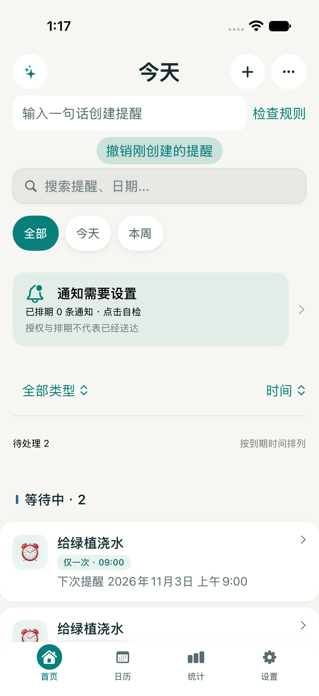
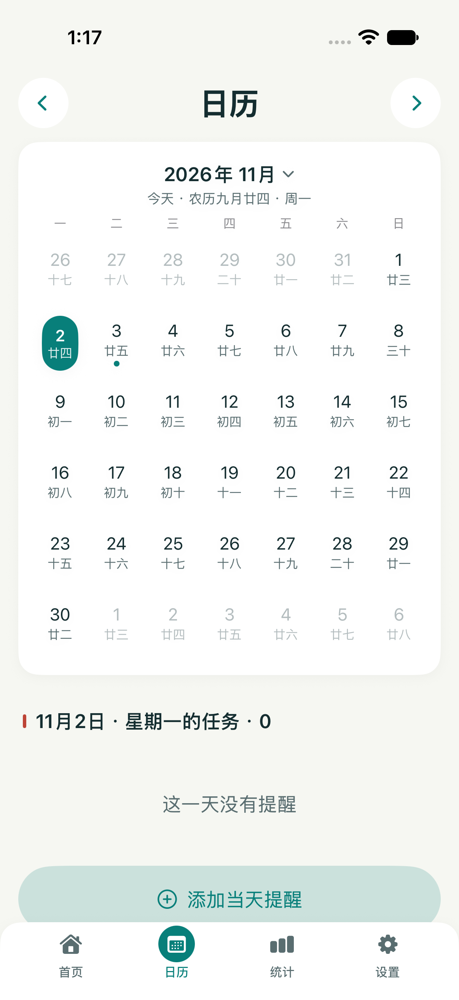
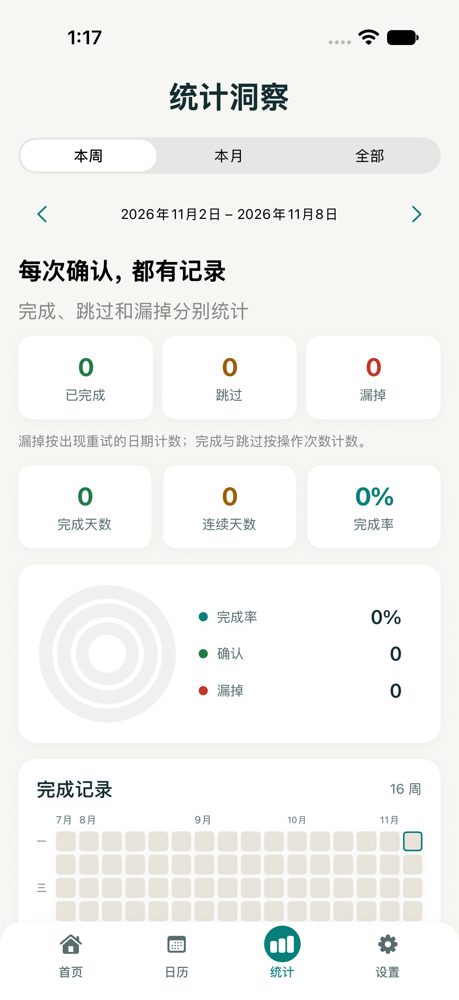
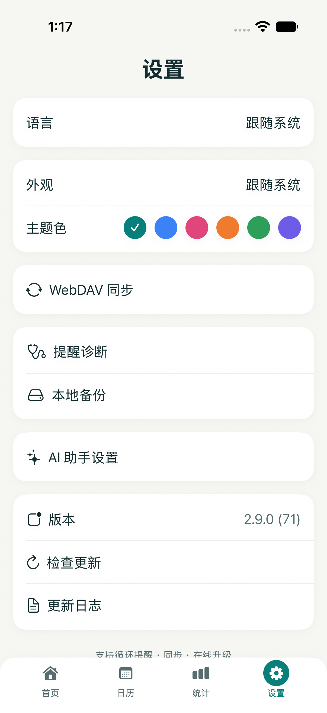

[简体中文](README.md) · [English](README.en.md) · [繁體中文](README.zh-TW.md) · [日本語](README.ja.md) · [한국어](README.ko.md)


# 循環提醒

**把待確認的事，放在第一眼。**

原生 iOS 與 Android 提醒工具。確認後進入下一週期；尚未確認時，依你設定的強度與間隔再次提醒。資料先留在本機，同步由你選擇。

版本 **2.9.1 / 72** · unsigned IPA。下載狀態與更新記錄以 Releases 為準。

2.9.1 修正同步內容未變時的重複衝突提示及上傳失敗的重試狀態；真正的衝突仍須選擇。[更新說明](docs/releases/v2.9.1.md)。

[**下載與版本記錄 ↗**](https://github.com/tsumon/reminder-app-ios/releases/latest) · [另一平台](https://github.com/tsumon/reminder-app-android)

## 能做什麼

| 能力 | iOS | Android |
| :--- | :---: | :---: |
| 週期、日期、農曆生日、節日、第 N 週規則 | ✓ | ✓ |
| 固定週期 / 完成後重新計時 | ✓ | ✓ |
| 輕柔 / 持續 / 重要、重試與每日勿擾 | ✓ | ✓ |
| 確認、稍後、明天、略過、撤銷 | ✓ | ✓ |
| 搜尋、類型組合篩選、時間 / 標題 / 優先級排序 | ✓ | ✓ |
| 當日行程、週 / 月統計、小工具 | ✓ | ✓ |
| 離線自然語言、語音、範本、可設定 AI 填表 | ✓ | ✓ |
| JSON、ICS、附近分享、本機備份、WebDAV | ✓ | ✓ |

## 三步開始

1. 建立提醒，或用一句話、語音與範本填寫，再檢查完整規則。
2. 選擇強度、週期起點、重試間隔與勿擾時段，預覽未來三次安排後儲存。
3. 開啟首頁通知自檢，檢查權限與系統設定，安排測試提醒並鎖定螢幕驗證。

## 實裝畫面

只展示真實執行畫面。範例提醒屬於獨立測試裝置，並非預設使用者資料。

<p align="center">
  
  
</p>
<p align="center">
  
  
</p>

[Create form](docs/screenshots/runtime-2.9/create.png) · [Capture details](docs/screenshots/runtime-2.9/README.md)

## 提醒策略

**固定週期**保留原定安排；假日前移後提前完成會消耗原定週期。**完成後重算**依實際確認時間重新計時。舊提醒保留原策略。

**輕柔**只自動提醒一次；**持續**預設 60 → 240 → 720 → 1440 分鐘，最多 5 次（含首次），可逐項編輯；**重要**仍由系統權限決定。重試遵守勿擾。

依裝置日曆與既有錨點時間戳計算。切換時區不會改寫舊錨點，請檢查下次提醒。預覽假設準時確認，假日資料更新後可能調整。

完成與略過依操作次數分開計數；漏掉依出現重試的日期計數，不代表系統已送達通知。

## 同步與恢復

WebDAV 使用你自己的伺服器。雙方修改時暫停並等待選擇；寫入前保留私有本機快照，以上傳 ETag 條件避免覆蓋新版本。協定 v4 依穩定 ID 合併歷史，以刪除標記防止舊提醒或已撤銷的記錄回流。

完整歷史與刪除同步需要雙端升級。v1–v3 備份仍可讀，但舊客戶端會丟棄新資料；無穩定 ID 的古老檔案無法可靠辨識刪除。標記長期保留，恢復需複製為新 ID，請保留 v4 完整備份。單條分享卡片不攜帶全域刪除標記。

## 安裝與覆蓋升級

iOS 17+。Release 工作流程輸出 unsigned IPA；繼續使用原有簽名 / 側載管道。App、Widget 與 App Group 保持原值；缺少原管道時，無法承諾覆蓋安裝或資料延續。

## 通知的真實邊界

權限與排程數量表示設定狀態，不代表已送達。靜音、專注 / 勿擾、通知管道、電源政策與廠商背景限制都可能影響提醒。請在真機鎖屏、重新啟動與背景狀態測試。

iOS 普通通知有待通知數量限制；重要提醒可在 iOS 26+ 另行授權 AlarmKit，不可用時回退普通通知。

## 本機建置

Xcode 26.3+ · XcodeGen · iOS 17+

```sh
xcodegen generate
xcodebuild build -project ReminderApp.xcodeproj -scheme ReminderApp \
  -sdk iphonesimulator -destination "generic/platform=iOS Simulator" \
  CODE_SIGNING_ALLOWED=NO
xcodebuild build -project ReminderApp.xcodeproj -scheme UpgradeCheck \
  -destination "platform=macOS" -derivedDataPath DerivedDataChecks CODE_SIGNING_ALLOWED=NO
./DerivedDataChecks/Build/Products/Debug/UpgradeCheck
```

App: `com.reminder.app` · Widget: `com.reminder.app.widget` · App Group: `group.com.reminder.app`

Release: `CODE_SIGNING_ALLOWED=NO` (unsigned IPA).

## 隱私

提醒與歷史保存在本機。AI 對話與相關內容會傳送到你設定的模型服務；WebDAV、附近分享與匯出檔案包含提醒資料，請選擇可信端點並妥善保管備份。

[**驗證與協定 →**](docs/upgrade-2.9.md) · [Validation](docs/validation-2.9.md)
